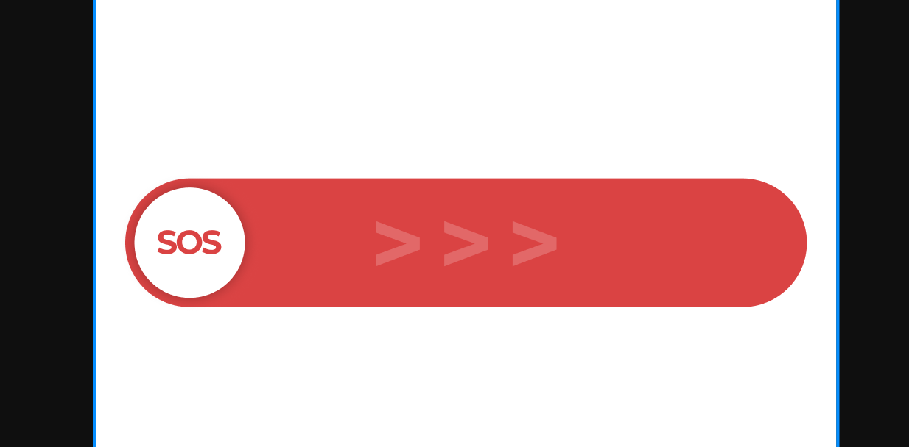

# Главный экран: ползунок SOS

Дата: 11 октября 2026 года.
Источник: прямое пожелание пользователя и приложенный пример интерфейса.
Статус: требование пользователя к способу активации SOS на главном экране.

Это дополнение заменяет описание обычной кнопки и активации нажатием на главном экране в разделе 8 исходного `QORGO_App_TZ.txt`. Исходный документ сохранён как архив. Другие способы активации из исходного ТЗ этим дополнением не пересматриваются.

## Внешний вид

Горизонтальная красная дорожка с полностью скруглёнными концами. В начальном положении слева расположен белый круглый ползунок с красной надписью SOS. Стрелки внутри дорожки показывают направление вправо. Элемент напоминает жест ответа на телефонный вызов.

## Основное требование

Пользователь захватывает круг SOS и тянет его вправо по всей длине дорожки. Тревога активируется только при достижении крайнего правого положения. Обычное нажатие и неполное перетаскивание не активируют SOS.

## Уточнения поведения для реализации

Следующие детали сформулированы при описании требования:

- Ползунок движется за пальцем только горизонтально и остаётся в границах дорожки.
- Правый край достигнут, когда правый край круга дошёл до конечного положения внутри дорожки с учётом её отступа. Для определения положения используется доступный ход ползунка, а не вся ширина экрана.
- Достижение конца активирует SOS сразу; дополнительное нажатие или отпускание пальца не требуется.
- Если пользователь отпустил палец до конца или жест прервался, круг возвращается в левое положение; тревога не отправляется.
- Одно завершённое перетаскивание запускает одну тревогу. Пока она активируется, повторные жесты не создают новые тревоги.
- После завершения жеста показывается состояние «Отправляем SOS…». Состояние «SOS отправлен» отображается только после подтверждения отправки, а при ошибке показывается понятный статус и возможность повторить отправку.
- Рядом с элементом размещается подсказка «Потяните вправо до конца, чтобы отправить SOS».

## Проверка при реализации

1. Нажатие на круг, дорожку или стрелки не отправляет SOS.
2. Перетаскивание на часть пути с отпусканием возвращает круг в начало.
3. Прерывание жеста до конца не отправляет SOS.
4. Перетаскивание до правого края запускает сценарий SOS ровно один раз.
5. Повторные касания во время активации не дублируют тревогу.
6. На экранах разной ширины ползунок проходит весь доступный путь, оставаясь внутри дорожки.
7. Интерфейс различает начало отправки, подтверждённую отправку и ошибку.

Доступность управления для пользователей, которым трудно выполнить перетаскивание, требует отдельного решения при проектировании приложения.
